# Personal Fitness OS — Arsitektur

Dokumen ini memenuhi 15 butir "expected output" dari spesifikasi. Status: **Phase 1–6 (fondasi, nutrisi, workout & aktivitas, body/recovery/hidrasi, goals & analytics, AI) selesai dan terverifikasi**; hanya Phase 7 (hardening) yang menunggu persetujuan.

## 1. Diagram arsitektur

```
Browser (React 19, Tailwind, shadcn/ui, Recharts)
   │  HTML streaming / RSC payload / Server Action POST
   ▼
Vercel ── Next.js 15 App Router
   │   middleware.ts ........ refresh sesi + proteksi rute
   │   Server Components .... baca data (dashboard, daftar)
   │   Server Actions ....... mutasi dari form (validasi Zod ulang di server)
   │   Route Handlers /api .. endpoint modular, upload, AI, cron
   │
   │  @supabase/ssr (cookie sesi, publishable key  → RLS berlaku)
   │  @supabase/server (Build APIs, stateless JWT verification)
   │  admin client (secret key, server-only → hanya job tepercaya)
   ▼
Supabase
   ├── Auth ............ identitas (email/password, Google)
   ├── PostgreSQL ...... master data + user data + fungsi bisnis + RLS
   └── Storage ......... bucket privat (avatars, progress-photos, food-scans)

Server-side saja ──► Penyedia AI (vision + teks). Tidak pernah dipanggil dari browser.
```

## 2. Technology stack
Next.js 15 (App Router) · TypeScript strict · Tailwind CSS 3 + shadcn/ui (Radix) · Lucide · React Hook Form + Zod · Recharts (Phase 5) · Supabase (Postgres 17, Auth, Storage, RLS) + @supabase/server + @supabase/ssr · Vercel · Vitest · PGlite (verifikasi schema tanpa Docker).
Tidak ada backend terpisah: semuanya modular di dalam Next.js.

## 3. Struktur folder
```
supabase/migrations/   001…011 (+012 dihasilkan importer)
scripts/               verify-schema.mjs · import-starter-data.mjs · starter-data.mapping.json
src/
  app/
    (marketing)/       landing
    (auth)/            login, register
    (dashboard)/       dashboard, settings, (modul fase berikut)
    auth/callback/     tukar code → sesi
    api/               health (+ endpoint fase berikut)
  components/          ui/ · dashboard/ · auth/ · settings/ · (nutrition, workout, … per fase)
  features/            auth/ · profile/ · dashboard/ · (nutrition, workout, … per fase)
  lib/                 supabase/ · auth/ · validations/ · calculations/ · api/ · errors.ts · env*.ts
  constants/ types/ utils/ hooks/
```
Aturan: logika bisnis di `features/` dan `lib/`, bukan di komponen UI.

## 4. ERD (ringkas)

```mermaid
erDiagram
  auth_users ||--|| profiles : "id"
  auth_users ||--|| user_settings : ""
  auth_users ||--|| user_preferences : ""
  auth_users ||--|| notification_preferences : ""
  auth_users ||--o{ streaks : ""
  food_categories ||--o{ food_items : ""
  food_items ||--o{ food_servings : ""
  units ||--o{ food_servings : "unit_code"
  auth_users ||--o{ custom_foods : ""
  custom_foods ||--o{ custom_food_ingredients : ""
  food_items ||--o{ custom_food_ingredients : ""
  auth_users ||--o{ recipes : ""
  recipes ||--o{ recipe_ingredients : ""
  auth_users ||--o{ food_logs : ""
  food_logs ||--o{ food_log_items : ""
  food_items |o--o{ food_log_items : "snapshot"
  exercise_categories ||--o{ exercises : ""
  auth_users ||--o{ workout_plans : ""
  workout_plans ||--o{ workout_plan_exercises : ""
  exercises ||--o{ workout_plan_exercises : ""
  auth_users ||--o{ workout_sessions : ""
  workout_sessions ||--o{ workout_session_exercises : ""
  workout_session_exercises ||--o{ workout_sets : ""
  auth_users ||--o{ personal_records : ""
  activity_types ||--o{ activity_logs : ""
  auth_users ||--o{ goals : ""
  goals ||--o{ goal_progress : ""
  goal_templates |o--o{ goals : ""
  achievement_definitions ||--o{ user_achievements : ""
  auth_users ||--o{ ai_conversations : ""
  ai_conversations ||--o{ ai_messages : ""
  ai_food_scans |o--o{ food_log_items : ""
```


## 5. Definisi tabel
**Master (read-only untuk klien)** — `units`, `food_categories`, `food_items`, `food_servings`, `exercise_categories`, `exercises`, `activity_types`, `goal_templates`, `achievement_definitions`.
- PK `bigint identity BY DEFAULT` agar **ID dataset asli dapat dimasukkan eksplisit**; ID non-numerik → `source_id`.
- Gizi disimpan **per `base_quantity` `base_unit`** (default 100 g/ml). Porsi rumah tangga di `food_servings.base_amount` (gram/ml).
- `achievement_definitions` = (`metric`, `threshold`) agar evaluasi generik di SQL.

**User** — `profiles`, `user_settings`, `user_preferences`, `notification_preferences`, `streaks`, `notifications`, `weight_logs`, `body_measurements`, `progress_photos`, `sleep_logs`, `recovery_logs`, `water_logs`, `goals`, `goal_progress`, `user_achievements`, `workout_*`, `personal_records`, `activity_logs`, `custom_foods`, `custom_food_ingredients`, `recipes`, `recipe_ingredients`, `favorite_foods`, `food_logs`, `food_log_items`, `ai_*`.
Definisi lengkap dengan constraint ada di `supabase/migrations/002…006`.

Keputusan desain penting:
- **Snapshot**: `food_log_items` menyimpan nama + gizi saat dicatat → riwayat tidak berubah jika master data/resep diubah.
- **Kolom `logged_on date`** diisi server memakai zona waktu pengguna ("hari logis"), bukan `now()::date` UTC.
- **Satu workout aktif per user** (partial unique index).
- **PR menyimpan riwayat** (satu baris per rekor baru) untuk grafik progresi.
- **Batas aman**: target kalori ≥ 1.200 kcal ditegakkan oleh CHECK constraint.

## 6. Relasi
Lihat ERD. Aturan hapus: data user `ON DELETE CASCADE` dari `auth.users`; referensi ke master `RESTRICT` (latihan/aktivitas) atau `SET NULL` (makanan di log, karena ada snapshot).

## 7. Strategi RLS
- **RLS aktif di semua 45 tabel `public`** (dicek otomatis oleh `npm run db:verify`).
- Master: `SELECT` untuk `authenticated`; tidak ada policy tulis + `REVOKE INSERT/UPDATE/DELETE`.
- Tabel user: 4 policy `(select auth.uid()) = user_id` (sub-select agar dievaluasi sekali per query).
- Tabel anak tanpa `user_id`: policy memanggil `private.owns_*()` (SECURITY DEFINER, schema `private` tidak terekspos API).
- **Guard lintas-referensi**: `with check` memastikan `custom_food_id`, `recipe_id`, `plan_id`, `goal_id` yang dirujuk milik pemanggil.
- **Dikelola server** (klien hanya `SELECT`): `streaks`, `user_achievements`, `personal_records`, `ai_usage_logs`; `notifications` tanpa INSERT klien. Penulisan lewat fungsi `SECURITY DEFINER` atau service role.
- `anon` tidak punya akses tabel.

## 8. Strategi autentikasi
Supabase Auth = sumber kebenaran identitas; password tidak pernah disimpan aplikasi. Trigger `on_auth_user_created` membuat otomatis `profiles`, `user_settings`, `user_preferences`, `notification_preferences`, dan 4 baris `streaks`. Middleware me-refresh cookie dan memakai `getUser()` (validasi ke server Auth, bukan `getSession()`). Pesan login sama untuk email salah/password salah. Redirect `?next=` divalidasi (anti open-redirect). Google OAuth: aktif setelah dikonfigurasi (`NEXT_PUBLIC_GOOGLE_AUTH_ENABLED=true`).

## 9. Strategi storage
Tiga bucket **privat**: `avatars` (2 MB), `progress-photos` (8 MB), `food-scans` (8 MB), dengan batas MIME. Path wajib `<user_id>/<file>`; policy `storage.foldername(name)[1] = auth.uid()`. DB hanya menyimpan `storage_path` + metadata (ada CHECK `storage_path like user_id || '/%'`). Tampilan lewat signed URL berumur pendek yang dibuat server.

## 10. Struktur API
Mutasi dari form → **Server Actions** (hasil selalu `ActionResult`). Route Handlers dengan envelope `{data}` / `{error:{code,message}}`:
`/api/foods/search` · `/api/foods/[id]` · `/api/food-log[/id]` · `/api/workouts[/id][/start|/complete]` · `/api/activities` · `/api/body/{weight,measurements}` · `/api/recovery` · `/api/water` · `/api/goals` · `/api/achievements` · `/api/ai/{coach,food-scan,meal-assistant,workout-generator,weekly-review}`.
Pencarian makanan = RPC `search_foods` (trigram, ter-index, maks 50/halaman) — tidak pernah mengirim seluruh tabel ke browser.

## 11. Arsitektur AI
1. **Fakta dulu**: server menghitung data dari DB (ringkasan hari/minggu, sisa makro, recovery) → objek `facts`.
2. Model menerima `facts` + pertanyaan; keluaran disimpan **terpisah** (`facts` vs `recommendation`, plus `missing_data`).
3. Data tidak tersedia → AI wajib menyebut "tidak tersedia"; tidak boleh mengarang.
4. **Food scanner**: foto → bucket privat → vision → deteksi **(tidak tepercaya)** → dicocokkan ke `food_items` via `search_foods` → estimasi porsi → **konfirmasi pengguna** → baru jadi `food_log_items` (`source='ai_scan'`).
5. Meal assistant memakai sisa target + makanan nyata dari DB; workout generator mempertimbangkan waktu, alat, recovery, riwayat.
6. Guardrail: bukan dokter, tanpa diagnosis, tanpa restriksi kalori ekstrem (juga dijaga CHECK DB), rujuk tenaga kesehatan bila perlu.
7. Rate limit via `ai_usage_logs` yang hanya bisa ditulis service role. Kunci AI hanya di server.

## 12. Fase pengembangan
| Fase | Isi | Status |
|---|---|---|
| 1 | Fondasi: Next.js, auth, layout, tema, migrasi, RLS, seed, dashboard dasar, settings | **Selesai** |
| 2 | Nutrisi: pencarian, porsi, log, custom food, resep, favorit, mesin kalkulasi gizi | **Selesai** |
| 3 | Workout: library, builder, active workout, riwayat, PR; aktivitas/cardio | **Selesai** |
| 4 | Body, recovery, hidrasi, foto progres | **Selesai** |
| 5 | Goals, kalender, analytics, achievements, streak, notifikasi | **Selesai** |
| 6 | AI: coach, scanner, meal assistant, workout generator, weekly review | **Selesai** |
| 7 | Hardening: performa, a11y, empty/loading states, deployment | Menunggu persetujuan |

## 13. Arsitektur deployment
GitHub → Vercel (build `next build`, region dekat Supabase) → Supabase project (migrasi via `supabase db push`). Preview deployment memakai project/branch Supabase terpisah. Cron (Phase 5/6) lewat Vercel Cron memanggil `/api/cron/*` dengan header `CRON_SECRET`.

## 14. Environment variables
Lihat `.env.example`. Supabase Server (Build APIs): `SUPABASE_URL`, `SUPABASE_PUBLISHABLE_KEY`, `SUPABASE_SECRET_KEY`, `SUPABASE_JWKS_URL`. Publik (Next.js client bundle): `NEXT_PUBLIC_SUPABASE_URL`, `NEXT_PUBLIC_SUPABASE_ANON_KEY`, `NEXT_PUBLIC_SITE_URL`, `NEXT_PUBLIC_GOOGLE_AUTH_ENABLED`. **Server saja**: `SUPABASE_SERVICE_ROLE_KEY` (alias SUPABASE_SECRET_KEY), `AI_*`, `CRON_SECRET`. `lib/env.server.ts` mengimpor `server-only` sehingga build gagal bila terbawa ke client.

## 15. Pertimbangan keamanan
RLS di semua tabel · service role terisolasi · validasi Zod di server (dan batas CHECK di DB sebagai lapis kedua) · pesan error bersih tanpa detail DB (`lib/errors.ts`) · header keamanan (HSTS, X-Frame-Options, nosniff, Permissions-Policy) · open-redirect guard · bucket privat + signed URL · fungsi `SECURITY DEFINER` memakai `search_path=''` dan `auth.uid()` (bukan parameter user id) · tanggal streak dibatasi ±1 hari · achievement/PR/streak tak bisa ditulis klien · AI tidak pernah dipercaya sebagai data gizi.

---
## Phase 2 — Nutrisi (rancangan yang diimplementasikan)

**Alur data.** UI → (Server Action | Route Handler) → `features/nutrition/*` (service) → Supabase. Action dan API hanya lapisan tipis: autentikasi → validasi Zod → panggil service → `revalidatePath`. Logika tidak diduplikasi.

**Mesin kalkulasi** (`lib/calculations/nutrition.ts`, murni, 40+ tes): semua porsi dinormalisasi ke gram/ml → `calculateNutrition(per, baseAmount)`. Kode yang sama berjalan di server (nilai yang disimpan) dan browser (preview langsung). *Server tidak pernah menerima angka gizi dari klien* — hanya `{jumlah, satuan, servingId}`; kalori/makro dihitung ulang dari database.
- `buildPortionOptions`: porsi rumah tangga (`food_servings`) + satuan standar yang masuk akal secara fisik (makanan berbasis gram → g/kg/oz; berbasis ml → ml/l/sdt/sdm/cup/gelas). Satuan tak valid ditolak (`resolvePortion`), tidak ditebak.
- Custom food komposit & resep: total gizi dari bahan; "1 porsi" = seluruhnya (custom) atau total/servings (resep); keduanya juga bisa dicatat per gram. Pendekatan: ml dihitung 1:1 terhadap gram untuk bobot total (didokumentasikan).
- Snapshot: `food_log_items` menyimpan gizi saat dicatat; mengedit resep/makanan tidak mengubah riwayat.

**Pencarian.** RPC `search_foods` (peringkat: persis > awalan > mengandung > fuzzy trigram, ter-index, paginasi ≤50). Makanan pribadi & resep dicari terpisah (RLS) dan ditampilkan lebih dulu. Browser tidak pernah menerima seluruh tabel makanan. Jumlah query tetap (tanpa N+1): `loadFoodRefs` memuat campuran makanan/custom/resep dalam satu batch.

**Endpoint baru.** `GET /api/foods/search`, `GET /api/foods/[id]?kind=`, `GET|POST /api/food-log`, `PATCH|DELETE /api/food-log/[id]`. Mutasi memeriksa `Origin` (anti-CSRF) dan sesi; jawaban memakai envelope `{data}`/`{error}`.

**Database.** Migrasi `013_nutrition_functions.sql`: `save_custom_food` & `save_recipe` (SECURITY INVOKER, atomik: baris induk + bahan dalam satu transaksi, `user_id` dari `auth.uid()`). Streak `nutrition` dan achievement dipicu setelah log (best-effort, tak pernah menggagalkan log).

**Halaman.** `/nutrition` (diary per tanggal, ringkasan vs target, per waktu makan, edit/hapus) · `/nutrition/log` (pencarian, kategori, terbaru, favorit, dialog porsi) · `/nutrition/custom[/new|/id]` · `/nutrition/recipes[/new|/id]`.

**Verifikasi Phase 2.** `db:verify` 58/58 (termasuk RPC atomik, penolakan edit lintas-user, bahan resep milik user lain, RESTRICT hapus, upsert waktu makan idempoten). 55 unit test (contoh spesifikasi: 200 g nasi putih = 260 kcal; "My Breakfast"; "Indomie + telur + sosis"). Smoke test: API tanpa sesi → 401 JSON, POST tanpa Origin → 403.

---
## Phase 3 — Workout & Aktivitas (rancangan yang diimplementasikan)

**Database** (`014_workout_functions.sql`, semua diuji di `db:verify`):
| Fungsi | Peran |
|---|---|
| `search_exercises`, `exercise_facets` | pencarian toleran typo + filter otot/alat/level/gerakan/kategori; nilai filter dari satu query kecil |
| `save_workout_plan` | simpan plan + latihan **berurutan** atomik (reorder = urutan array; constraint posisi *deferrable*) |
| `start_workout` | salin latihan plan + buat otomatis `target_sets` set kosong; satu workout aktif per user (unique index parsial) |
| `complete_workout` | transaksi tunggal: buang set belum selesai, cache volume, status selesai, lalu `record_workout_prs` + streak + achievement. Tanpa set selesai → *rollback* |
| `previous_performance`, `exercise_history` | performa sesi terakhir per latihan (satu RPC untuk semua latihan, tanpa N+1) |
| `current_personal_records` | rekor terbaik saat ini per latihan/aktivitas & tipe (riwayat rekor tetap tersimpan untuk grafik progresi) |
| `record_activity_prs` | rekor jarak terjauh & pace tercepat (jarak ≥ 1 km; pace lebih kecil = lebih baik) |

**Kalkulasi** (`lib/calculations/workout.ts`, murni, dites): Epley e1RM (identik dengan SQL), volume (hanya set selesai, bukan pemanasan), `suggestProgression` (mis. 60×10 → 62,5×10; di bawah target → +1 rep), pace/kecepatan, estimasi kalori MET × berat × jam, parsing durasi `28:30`.

**Active workout** (`/workout/session/[id]`): input menyesuaikan `tracking_mode` (beban×reps, reps saja, durasi, jarak+waktu, beban+durasi); kolom *previous*, banner **saran progresi yang hanya ditawarkan** (tombol "Use", tidak pernah terisi otomatis), rest timer berbasis jam dinding (tetap akurat saat layar tidur) dengan ±15 dtk dan getar, update optimistik dengan rollback bila server menolak, RPE & set pemanasan, tambah/hapus set & latihan saat latihan berlangsung. Set-level action sengaja tanpa `revalidatePath` agar layar tidak ter-refresh saat berlatih.

**Aktivitas** (`/activity`): semua jenis dari `activity_types`; jarak/pace hanya bila jenisnya melacak; pace dihitung server; kalori diestimasi dari MET + berat terakhir bila kosong; ringkasan minggu ini; PR otomatis.

**Dashboard**: kartu Workout (berlangsung / selesai ✓ / terjadwal / kosong) + rekor terbaru.

**API** (envelope `{data}`/`{error}`, mutasi memeriksa Origin): `GET /api/exercises` · `GET|POST /api/workouts` · `GET|PUT|DELETE /api/workouts/{planId}` · `POST /api/workouts/{planId}/start` · `POST /api/workouts/{sessionId}/complete` · `GET|POST /api/activities` · `PATCH|DELETE /api/activities/{id}`. *Catatan:* `[id]` pada `/start` adalah **plan**, pada `/complete` adalah **session** (keduanya didokumentasikan di handler).

**Keputusan & batasan yang disengaja**
- Workout hanya bisa dimulai untuk hari ini (±1 hari, mengikuti jendela streak).
- Aktivitas kardio juga menghitung ke *workout streak*.
- Menghapus workout dari riwayat **tidak** mencabut rekor yang pernah diraih (klien memang tak boleh menulis `personal_records`); rekor tetap merujuk tanggal pencapaian.
- Urutan latihan di plan diubah dengan tombol naik/turun (aksesibel & ramah satu tangan), bukan drag-and-drop. Urutan latihan di tengah sesi aktif belum bisa diubah.
- Workout yang sudah selesai belum bisa diedit (agar volume/PR tidak tak sinkron); hapus lalu catat ulang.
- Belum ada mode offline di gym.

**Verifikasi Phase 3.** `db:verify` 91/91 (start/complete/rollback, satu workout aktif, reorder, e1RM Epley, PR tidak ganda, isolasi antar-user untuk semua RPC baru, PR aktivitas, achievement First 5K). 101 unit test (progresi, volume, e1RM, pace, kalori, validasi). Smoke test: rute terproteksi → 307, API tanpa sesi → 401, mutasi tanpa/dengan Origin asing → 403.

---
## Phase 4 — Body, Recovery, Hidrasi, Foto Progres (rancangan yang diimplementasikan)

**Database** (`015_body_recovery_functions.sql`): berat, ukuran, tidur, dan recovery memakai upsert biasa (constraint `UNIQUE (user, tanggal)` + CHECK adalah lapisan integritasnya); hanya air yang butuh fungsi.
| Fungsi | Peran |
|---|---|
| `add_water` | catat air, hitung total harian vs target, saat target tercapai → hydration streak + achievement. Tanggal mundur maks. 7 hari; 0 ml / >5 L ditolak |
| `water_totals` | total per hari untuk grafik (satu query `GROUP BY`, rentang dibatasi) |

**Berat & ukuran tubuh.** Satu berat per hari (mencatat ulang di tanggal sama = mengganti). Ukuran: hanya kolom yang diisi yang ditulis, jadi entri di tanggal yang sama **digabung**. Grafik tren dengan *moving average* 7 entri, perubahan, dan laju mingguan (hanya bila rentang ≥ 3 hari).

**Foto progres.** Browser mengecilkan foto (sisi terpanjang ≤ 1600 px, JPEG; metadata EXIF/GPS ikut terhapus) lalu **mengunggah langsung ke bucket privat** — sengaja tidak lewat Server Action karena Vercel membatasi body fungsi ±4,5 MB. Server lalu `registerPhotoAction`: path harus `<user_id>/<uuid>.<ext>` (`isOwnPhotoPath`), objek harus benar-benar ada, MIME dan ukuran **yang tersimpan di Storage** diperiksa ulang; jika gagal, file dihapus (tidak ada yatim). DB hanya menyimpan path + metadata. Tampilan memakai signed URL 1 jam (satu panggilan batch); bila kedaluwarsa, galeri meminta URL baru otomatis. Ada mode *Compare* (dua foto berdampingan, terlama di kiri).

**Recovery.** Skor 0–100 dari: durasi tidur 25 · kualitas tidur 10 · energi 20 · stres 15 (terbalik) · nyeri otot 15 (terbalik) · perasaan umum 15. Input yang kosong dikeluarkan dan bobot sisanya dinormalisasi, sehingga check-in parsial tetap bermakna (`coverage` memberi tahu "berdasarkan N dari 6 input"). Skor **dihitung ulang saat dibaca** dari tidur + check-in terbaru (tidak pernah basi bila tidur dicatat belakangan) dan di-cache di `recovery_logs.recovery_score` untuk analytics. Saran bersifat hati-hati dan bukan nasihat medis. Sinyal ini akan dipakai AI di Phase 6.

**Hidrasi.** Tombol 250 / 500 / 750 / 1000 ml yang besar, jumlah bebas, Undo, daftar hari ini, grafik 7 hari dengan garis target. Total diperbarui secara optimistik; versi ringkas (250/500 ml) juga ada di Dashboard.

**Dashboard.** Kartu Berat (terbaru + perubahan 14 hari), Tidur (vs target), Recovery (skor + pita), dan tombol tambah air.

**Grafik.** Recharts dimuat **lazy** (`next/dynamic`, tanpa SSR): halaman `/body/weight` hanya ±1 kB JS sendiri. Tiap grafik punya `role="img"` + label dan tabel data tersembunyi untuk pembaca layar.

**API** (envelope `{data}`/`{error}`, mutasi memeriksa Origin): `GET|POST /api/body/weight` · `DELETE /api/body/weight/{id}` · `GET|POST /api/body/measurements` · `DELETE /api/body/measurements/{id}` · `GET|POST /api/recovery` (`?date=` atau `?days=`) · `GET|POST /api/water` · `DELETE /api/water/{id}`.

**Keputusan & batasan yang disengaja**
- Tidur dicatat sebagai **durasi** (jam + menit) + kualitas; kolom jam tidur/bangun ada di DB tetapi belum dipakai UI.
- Menghapus entri air setelah target tercapai **tidak** menurunkan streak yang sudah naik.
- Tidak ada BMI atau penilaian berat ideal; hanya tren data milik pengguna.
- Foto memakai `` (bukan `next/image`) karena URL privat berumur pendek tidak boleh masuk cache pengoptimal gambar bersama.
- Avatar profil (bucket `avatars`) belum dibuat UI-nya; bucket dan policy-nya sudah siap.
- **Sistem satuan imperial belum didukung** di UI (kolom `unit_system` sudah ada); seluruh aplikasi saat ini metrik.

**Verifikasi Phase 4.** `db:verify` 119/119 (total & target air, hydration streak idempoten, jendela tanggal, batas nilai, upsert berat/tidur/ukuran, gabung ukuran, CHECK foto, path unik, isolasi antar-user). 159 unit test (skor recovery, tren, moving average, validasi, path foto, `fitWithin`). Satu bug ditemukan & diperbaiki lewat tes: `toFixed` membulatkan 0,35 ke "0.3" (kini pembulatan benar dan tidak pernah "+0.0"). Smoke test: rute terproteksi → 307, API tanpa sesi → 401, mutasi dengan Origin asing → 403.

---
## Phase 5 — Goals, Kalender, Analytics, Achievements, Streak, Notifikasi (rancangan yang diimplementasikan)

**Database** (`016_goals_analytics_functions.sql`, semua diuji di `db:verify`):
| Fungsi | Peran |
|---|---|
| `private.user_metrics` + `evaluate_achievements` (di-refaktor) | metrik achievement didefinisikan **sekali**; dipakai untuk membuka achievement dan menampilkan progresnya. Membuka achievement juga membuat notifikasi in-app |
| `achievement_progress` | semua achievement + nilai saat ini + tanggal terbuka (progres menuju yang terkunci) |
| `private.goal_value` | nilai goal **dihitung dari data Anda sendiri**: berat, ukuran, e1RM dari rekor, waktu lari (diekstrapolasi dari pace), km bulanan, rata-rata protein/serat/air 7 hari (hanya hari yang tercatat), workout/minggu, rata-rata tidur |
| `sync_progress` | satu panggilan: streak *habit*, perbarui semua goal aktif, riwayat progres (satu titik per goal per hari), selesaikan goal yang tercapai (+ notifikasi), evaluasi achievement. Tanggal dibatasi ±1 hari |
| `calendar_days` | satu baris per hari yang punya data (workout, aktivitas, kalori, air, tidur, berat, recovery); rentang dibatasi 63 hari |
| `analytics_workout`, `analytics_nutrition` | agregat mingguan, distribusi otot, latihan teratas, total harian, makanan terbanyak |

**Goals.** Lima tipe (Body, Strength, Running, Nutrition, Habit) + metrik *custom* yang diperbarui manual. Katalog metrik tunggal (`lib/goals/metrics.ts`) dipakai form, server, dan SQL. Progres `calculateGoalProgress` dua arah (75,4 → 70 kg turun; bench 60 → 80 naik), *pace* (lebih cepat/sesuai/tertinggal vs garis lurus waktu), hari tersisa. Validasi arah target vs nilai awal. Status `completed` hanya bisa ditetapkan server.

**Streak & achievement.** Streak dipelihara **inkremental** di DB; apakah masih hidup ditentukan saat dibaca (`effectiveStreak`: aktif jika ada aktivitas hari ini atau kemarin). *Habit streak* = hari berturut-turut dengan aktivitas terlacak apa pun. Halaman Achievements hanya menampilkan; klien tidak punya hak INSERT.

**Kalender.** Grid bulan (awal minggu mengikuti pengaturan), ikon per jenis data (bentuk, bukan hanya warna), tiap sel adalah tautan dengan `aria-label`; detail hari memuat Workout / Nutrisi / Air / Tidur / Berat / Recovery dengan tautan ke halaman terkait.

**Analytics.** Tiga tab (hanya data tab aktif yang diambil) × rentang 30/90/180 hari. Workout: frekuensi & volume mingguan (zero-filled), distribusi otot, progres e1RM per latihan dan riwayat PR. Nutrisi: rata-rata (hanya hari tercatat), konsistensi, kalori & protein vs target, distribusi makro (jumlahnya tepat 100%), makanan terbanyak. Gaya hidup: tidur, air, recovery, konsistensi workout, tren berat.

**Notifikasi kontekstual.** Mesin aturan **murni** (`lib/notifications/rules.ts`, diuji ketat) menerima snapshot data pengguna + preferensi dan menentukan pesan: *"Push Day is scheduled today."*, *"You still need approximately 35g protein…"*, *"You're about 600ml below your usual water intake so far."*, *"You only slept 5h 40m. Consider reducing today's training intensity."*, plus streak yang akan berakhir dan goal yang mendekati tenggat. **Anti-spam:** jam tenang (boleh melewati tengah malam), batas harian, satu pesan per topik per hari (`dedupe_key` + unique di DB), tidak menegur protein bila hari itu tidak mencatat makanan, tiap kategori bisa dimatikan. Penyisipan memakai klien service-role karena klien tidak boleh membuat notifikasi (tak bisa dipalsukan); dibatasi ke `userId` yang sudah diverifikasi. Pembuatan dipicu saat aplikasi dibuka (throttle 15 menit) oleh `NotificationSync`.

**API**: `GET|POST /api/goals` · `GET|PATCH|DELETE /api/goals/{id}` (`PATCH`: `{status}` atau `{value,date}` untuk goal custom) · `GET /api/achievements` (achievement + streak) · `GET /api/notifications`. Envelope `{data}`/`{error}`, mutasi memeriksa Origin.

**Keputusan & batasan yang disengaja**
- Notifikasi **hanya in-app** (tanpa push/email) dan dibuat saat aplikasi dibuka, bukan oleh cron latar belakang. Tanpa `SUPABASE_SERVICE_ROLE_KEY`, notifikasi kontekstual dinonaktifkan secara senyap (notifikasi achievement/goal tercapai tetap muncul karena dibuat oleh fungsi DB).
- Progres goal dihitung saat membuka halaman Goals/Achievements dan saat aplikasi dibuka (≤ 1× per 15 menit), bukan setelah setiap pencatatan; dashboard menampilkan nilai tersimpan (sesuai prinsip "jangan hitung ulang semuanya di setiap render").
- Waktu lari (mis. 5K) adalah **perkiraan** dari pace lari ≥ jarak tersebut.
- Menghapus data tidak menurunkan streak atau mencabut achievement yang sudah terbuka.
- Mengedit goal mengaktifkannya kembali dan menghitung ulang progres.
- Bar mingguan pertama/terakhir pada analytics bisa merupakan minggu parsial.

**Verifikasi Phase 5.** `db:verify` 155/155 (nilai goal per metrik, penyelesaian arah turun/naik, satu titik progres per hari, notifikasi goal sekali saja, progres achievement, kalender, agregat analytics, isolasi antar-user, klien tak bisa membuat notifikasi). 211 unit test (progres/pace goal, streak, grid kalender, agregat analytics, seluruh aturan notifikasi termasuk anti-spam). Dua bug ditemukan & diperbaiki lewat tes: tenggat goal ditolak oleh validator tanggal log harian (kini punya batas sendiri, hingga 10 tahun), dan ekspektasi pembulatan. Smoke test: rute terproteksi → 307, API tanpa sesi → 401, mutasi dengan Origin asing → 403.

---
## Phase 6 — AI (rancangan yang diimplementasikan)

**Penyedia:** Google Gemini lewat REST `generateContent` (tanpa SDK, jadi perilakunya eksplisit dan bisa diuji). Model default `gemini-3.8-flash` untuk teks dan vision; keduanya dapat diganti lewat env (`AI_MODEL_TEXT`, `AI_MODEL_VISION`, `AI_BASE_URL`).

**Prinsip arsitektur**
1. **Fakta dulu, AI belakangan.** Server menyusun snapshot data pengguna dari database (`buildCoachFacts`: 14 hari — workout, nutrisi, tidur, air, recovery, berat, target, goal, streak, daftar *data yang tidak ada*). Model hanya mengomentari snapshot itu; ia tidak menghasilkan fakta. Baris "Your data used" yang dilihat pengguna dihitung server (`describeFacts`), bukan ditulis model. Daftar area tanpa data dihitung server (`computeMissing`) dan dikirim ke model, sehingga "data tidak tersedia" tidak bergantung pada model yang menyadarinya.
2. **Output model tidak pernah dipercaya.** Setiap jawaban melewati Zod; ID makanan/latihan harus berasal dari daftar kandidat yang kami kirim (model tidak bisa mengarang makanan atau latihan); jumlah dibatasi; **semua angka gizi dihitung ulang oleh kalkulator kami** dari data database.
3. **Satu jalur** (`lib/ai/run.ts`): terkonfigurasi? → dalam batas harian? → panggil Gemini → parse JSON → validasi (satu kali retry bila tidak valid) → catat token → kembalikan data. Pemakaian dicatat juga saat gagal sehingga error tidak bisa dipakai menghindari batas.
4. **Gagal tertutup.** AI aktif hanya jika `AI_API_KEY` **dan** `SUPABASE_SERVICE_ROLE_KEY` ada: log pemakaian ditulis dengan service role agar pengguna tak bisa menghapus/memalsukannya. Tanpa itu AI mati (dengan pesan jelas), bukan berjalan tanpa penjaga biaya.
5. **Kunci hanya di server.** Dikirim hanya lewat header `x-goog-api-key`, tidak pernah di URL, body, log, pesan error, atau respons; kunci yang dipantulkan penyedia disamarkan (`redactSecrets`); isi error penyedia tidak pernah ditampilkan ke pengguna (dipetakan ke pesan aman).

**Fitur**
| Fitur | Cara kerja |
|---|---|
| **Coach** `/coach` | Chat dengan riwayat tersimpan. Menampilkan jawaban, rekomendasi, "Data not available", dan "Your data used" (dari server) **terpisah**. |
| **Insight harian** (dashboard) | Satu catatan singkat per hari (upsert), fakta disimpan terpisah dari teks AI (`ai_insights.facts` vs `recommendation`). |
| **Meal assistant** | Sisa target hari ini dihitung server (`calculateRemainingMacros`). Kandidat: `meal_candidates()` (beragam per kategori, tanpa makanan yang tidak disukai) + favorit/terbaru. Opsi yang melebihi sisa kalori >20% dibuang. Tombol "Log" memakai nilai database. Bila target sudah tercapai → tanpa panggilan AI. |
| **Workout generator** | Kandidat dari `exercise_candidates()` (hanya alat yang dimiliki + bodyweight; pemula tak dapat gerakan *advanced*). Server memangkas latihan, set, lalu istirahat agar muat waktu; volume dibatasi bila recovery < 50. "Add to Workout Plan" membuat plan biasa yang bisa diedit. |
| **Weekly review** | Angka mingguan (format brief: Workout 4/5, Calories 2210 average, …) dihitung dari DB dan ditampilkan **terpisah** dari teks AI (apa yang berjalan baik / perlu diperbaiki / rekomendasi). Tersimpan dan bisa dibuka lagi. Minggu kosong → tanpa panggilan AI. |
| **Food scanner** | Foto → diperkecil di browser → diunggah ke bucket privat → Gemini vision → setiap item dicocokkan ke database (beberapa istilah pencarian, termasuk nama Indonesia) → **pengguna meninjau dan mengonfirmasi** (ganti kecocokan, ubah gram, lewati) → baru dicatat (`source='ai_scan'`). Gizi tetap dari database. Foto dihapus setelah konfirmasi/buang. |

**Keselamatan** (`lib/ai/safety.ts`)
- **Penyaring pesan sebelum model dipanggil:** darurat medis / bahaya diri, gangguan makan, dan permintaan diet ekstrem (<1.200 kkal/hari atau turun ≥3 kg per minggu) dijawab dengan balasan tetap yang hati-hati — tanpa panggilan model, tanpa biaya, tanpa risiko balasan berbahaya. Pertanyaan medis tetap dijawab tetapi ditandai "konsultasikan tenaga profesional". Pesan sah seperti "defisit 500 kkal per hari" atau "makan malam di bawah 600 kalori" tidak ikut terblokir (diuji).
- **Penyaring keluaran:** jawaban yang menyarankan asupan di bawah batas dibuang/diganti. Batas 1.200 kkal juga ditegakkan oleh CHECK di database.
- **Prompt sistem:** hanya fakta di `<data>`; tidak mengarang; sebut data yang tidak ada; bukan dokter; data dan pesan pengguna diperlakukan sebagai data, bukan instruksi (anti prompt-injection).
- **Privasi:** nama, email, dan ID pengguna tidak dikirim ke model; foto hanya dikirim saat Anda memindai.

**Batas pemakaian:** `AI_DAILY_LIMIT` (default 40) dan `AI_DAILY_VISION_LIMIT` (default 10) per pengguna per 24 jam bergulir, dihitung dari `ai_usage_logs`.

**Database** (`017_ai_functions.sql`): `meal_candidates`, `exercise_candidates`, unique `(user, tanggal, jenis)` untuk insight. Tabel AI dari 006 dipakai apa adanya; semua dilindungi RLS.

**API:** `POST /api/ai/coach` · `/meal-assistant` · `/workout-generator` · `/food-scan` · `GET|POST /api/ai/weekly-review` · `GET|POST /api/ai/status` (cek koneksi tanpa token). Mutasi memeriksa Origin dan sesi; `maxDuration = 60`.

**Batasan yang perlu diketahui**
- **Belum diuji terhadap Gemini sungguhan.** Sandbox pengembangan tidak punya akses jaringan ke Google dan kunci Anda tidak saya pakai. Seluruh klien diuji dengan `fetch` tiruan (header, pemetaan error, retry, token, pencegahan kebocoran kunci). Kualitas jawaban, kecocokan skema respons dengan API, dan akurasi vision terhadap masakan Indonesia belum terbukti.
- **Format kunci `AQ.`:** dokumentasi Google menyatakan didukung lewat header `x-goog-api-key`, tetapi beberapa pengguna melaporkan error `401 ACCESS_TOKEN_TYPE_UNSUPPORTED`. Gunakan tombol **"Check AI connection"** di halaman Coach untuk mendiagnosis.
- Teks bebas jawaban model tidak bisa diverifikasi kata per kata. Mitigasinya: model hanya diberi fakta, angka pengguna ditampilkan dari server, dan keluaran terstruktur divalidasi; tetapi model tetap bisa keliru.
- Kandidat meal assistant hanya makanan master (bukan custom/resep). Batasan diet diteruskan ke model (nasihat, bukan jaminan); hanya makanan yang tidak disukai yang disaring di SQL. Selalu ada peringatan alergi.
- Penyaring keselamatan berbasis kata kunci (Inggris + sebagian Indonesia); sengaja sederhana dan konservatif, bukan jaminan menyeluruh.
- Syarat penggunaan Gemini (termasuk penggunaan data oleh Google) bergantung paket/akun Anda; periksa sebelum merilis ke pengguna lain dan sebutkan dalam kebijakan privasi.

**Verifikasi Phase 6.** `db:verify` 181/181 (kandidat makanan/latihan, pengecualian makanan tidak disukai, filter alat, isolasi AI antar-user, klien tak bisa menulis/menghapus log pemakaian). 308 unit test: klien Gemini (header vs URL, pemetaan 401/403/429/404/400, retry 503, kebocoran kunci, blokir/kosong/terpotong), penyaring keselamatan (≈35 kalimat termasuk kasus yang tak boleh terblokir), validator makanan/latihan/scan, orkestrator `runAi` (tidak terkonfigurasi, batas harian, retry JSON, pencatatan token, pesan error aman), fakta & input. Bug ditemukan & diperbaiki lewat tes: layar keselamatan meloloskan "only 500 calories a day"; generator workout bisa melebihi waktu bila 2 latihan minimum sudah terlalu panjang (kini set dan istirahat ikut dipangkas).

---
## Verifikasi Phase 1 (sudah dijalankan)
- `npm run db:verify` → **47/47 lulus**: bootstrap user, isolasi RLS antar user (tabel induk & anak), guard lintas-referensi, pencarian (typo-tolerant), agregat harian, streak, PR (Epley), achievement idempoten, policy storage, semua tabel ber-RLS.
- `npm run typecheck`, `npm run lint`, `npm test` (21 tes), `npm run build` → lulus. Smoke test: rute publik 200, rute terproteksi → 307 ke `/login?next=…`.
- **Belum bisa diuji di sini**: alur login nyata ke proyek Supabase (butuh kredensial Anda) dan tampilan visual di browser.
